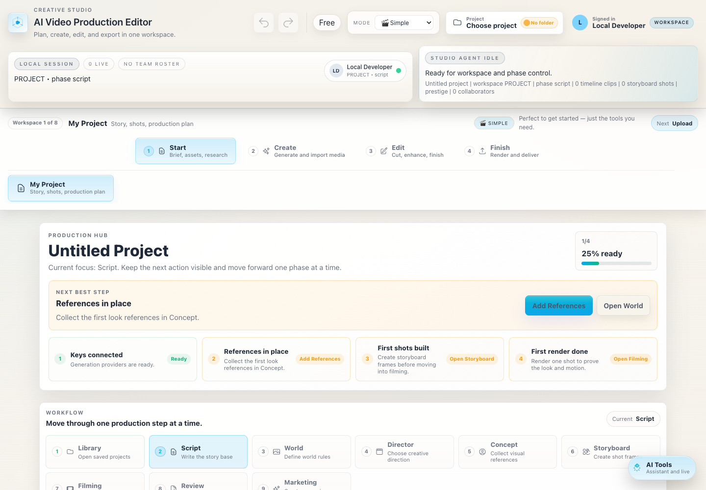
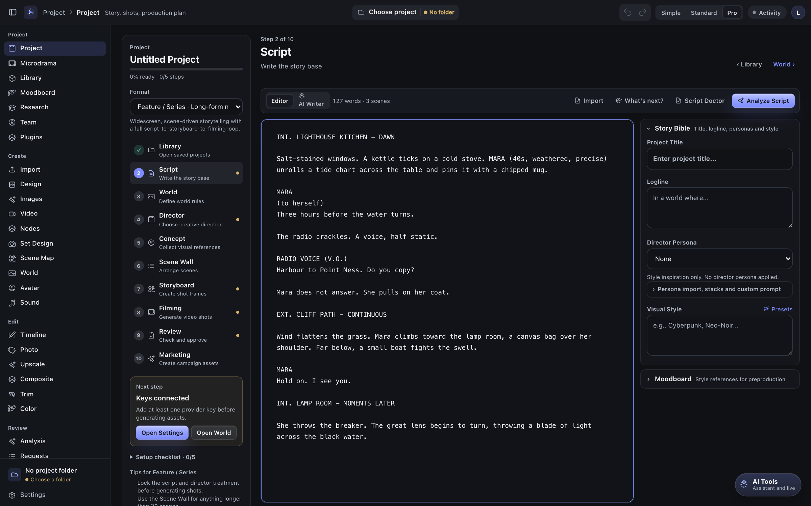
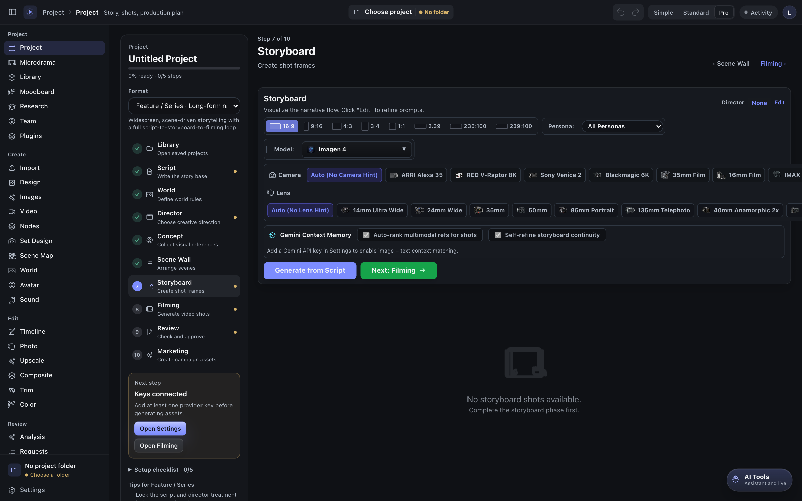
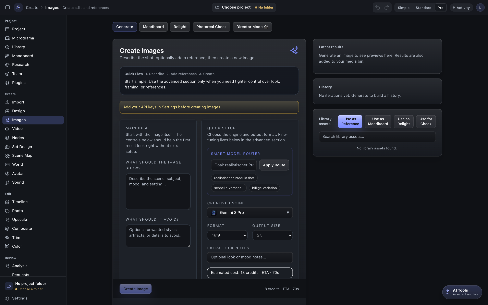
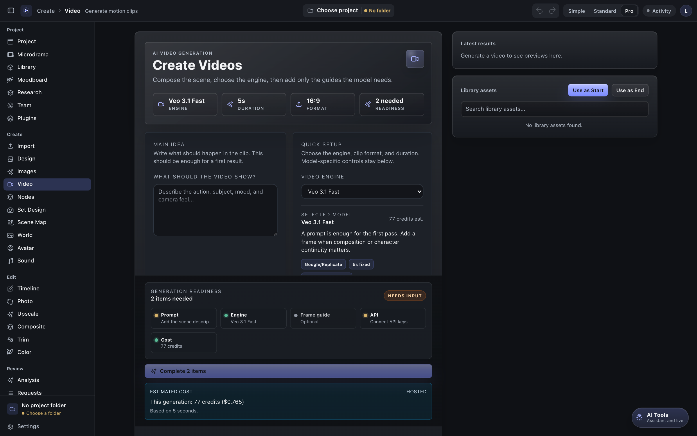

# First 10 Minutes: Beginner Walkthrough

This guide is for people who just found the repository and want to open the app, understand the core workflow, and create their first generation project in under 10 minutes.

Prefer to watch? The [4-minute video setup](https://youtu.be/p99IG1m5ybU) covers install, the welcome guide, the studio layout, project folders, and the Project Hub.

---

## 1. Getting the App

### Option A: Prebuilt Desktop Installers (Recommended for Creators)
If you simply want to run the studio without configuring a Node.js development environment:
- Download the latest signed package from [GitHub Releases](https://github.com/LudwigKienle/ai-video-production-editor/releases/latest).
- **macOS:** Download the `.dmg` (Apple Silicon or Intel).
- **Windows:** Download the `.exe` installer.
- Launch the application, choose or create a local project directory, and enter your provider API keys under Settings.

### Option B: Running from Source (For Developers)
Clone the repository and install dependencies:

```bash
git clone https://github.com/LudwigKienle/ai-video-production-editor.git
cd ai-video-production-editor
npm install
```

#### Browser Dev vs. Electron Desktop Dev
The application supports two distinct local development workflows:

| Mode | Command | Best For | Details |
| --- | --- | --- | --- |
| **Browser Dev** | `npm run dev` | UI & Frontend Iteration | Starts a Vite dev server at `http://localhost:5173/studio.html`. Delivers fast Hot Module Replacement (HMR) for developing React components, CSS, and web layouts. |
| **Electron Dev** | `npm run electron:dev` | Full Desktop Experience | Compiles the Electron main and preload processes and runs the native desktop container. Enables native filesystem access, local file exports, and native application menus. |

---

## 2. Visual Walkthrough: First 10 Minutes in the Studio

### Step 1: First Launch & Studio Overview
When you first open the studio, you are greeted by the macOS-style production shell with a source-list sidebar, slim toolbar, and quick access to projects.



The studio organizes production into a single continuous loop:
```text
Script → Director pass → Concept & casting → Storyboard → AI filming → Continuity review → Export
```

### Step 2: Input Your Script or Load the Demo Project
Navigate to the **Script** tab in the sidebar. You can paste your own screenplay or use the preloaded demo files in `examples/demo-project`:
- `script.md`
- `project-brief.md`
- `shot-list.md`



Create a new project named `Rainline` and paste the script into the editor. The Director agent can automatically parse scenes, identify speaking characters, and flag required visual elements.

### Step 3: Run the Director Pass & Build the Storyboard
Switch to the **Storyboard** view. The Director pass turns your screenplay into structured shot cards with camera bodies, lenses, and framing rules.



- Set camera lenses (e.g., 35mm Prime, 50mm Anamorphic).
- Choose director styles and aspect ratios (16:9, 9:16, 2.39:1).
- Use Gemini continuity review to verify visual consistency across shots.

### Step 4: Concept Generation & AI Filming
Open the **Filming & Generation** workspace to generate image frames and video shots using integrated providers (fal.ai, Replicate, Gemini, Runway, Kling, Seedance, WAN, LTX).





- Use **Auto Model** or manually select engines tailored for performance, characters, or landscapes.
- Turn approved storyboard frames into motion clips with start/end frame interpolation.

### Step 5: Advanced Visual Pipelines in Node Space
For non-linear generation and complex multi-model pipelines, switch to **Node Space**.


- Connect `Prompt → Image Model → Sampler → Output` graphs.
- Use pre-built blueprints or build custom node chains.

---

## 3. Use the Demo Project

Open the demo files in `examples/demo-project`:

- `script.md`
- `project-brief.md`
- `shot-list.md`

Create a new project named `Rainline` and paste the script into the Script or
Project Hub script field. The brief and shot list give you continuity anchors
to compare against generated Director/storyboard results.

Suggested first test:

1. Run a Director pass.
2. Apply the Director treatment.
3. Generate concepts for Mira, the memory device, and the neon market street.
4. Generate storyboard frames for shots 1, 3, 5, and 9.
5. Generate one video clip from an approved frame.
6. Run continuity review after rendered shots exist.

## 4. Inspect the Code by Capability

Start with the [Capability Map](CAPABILITY_MAP.md). It links public product
capabilities to code areas, including:

- `src/workspaces/ProjectHubWorkspace.tsx`
- `src/services/studioAgentTaskService.ts`
- `src/services/studioAutomationService.ts`
- `src/services/geminiEmbeddingService.ts`
- `src/workspaces/NodeWorkspace.tsx`
- `src/utils/vfxHandoffManifest.ts`

This is the fastest way to see that the app is a production system, not only a
single prompt form.

## 5. Pick One Useful Contribution

If you want to help, start small:

- improve one setup or workflow doc,
- add screenshots for one workspace,
- fix one provider error message,
- document one Node Space graph,
- add one focused test around a pure utility.

Use [Contributor Paths](CONTRIBUTOR_PATHS.md) to choose a lane.

## 6. What to Avoid

- Do not commit `.env`, `.env.local`, provider keys, certificates, generated
  private media, release builds, or local virtual environments.
- Do not add a provider model unless the inputs, cost behavior, and failure
  modes are understandable to users.
- Do not start with a huge refactor. The app has many production surfaces, so
  small verified changes are easier to review.

## Quick Commands

```bash
npm run build:web
npm test
npm run check:public-release
```

For Electron package builds:

```bash
npm run electron:build
```

Official public installers should be attached to GitHub Releases, not committed
to the repository.
