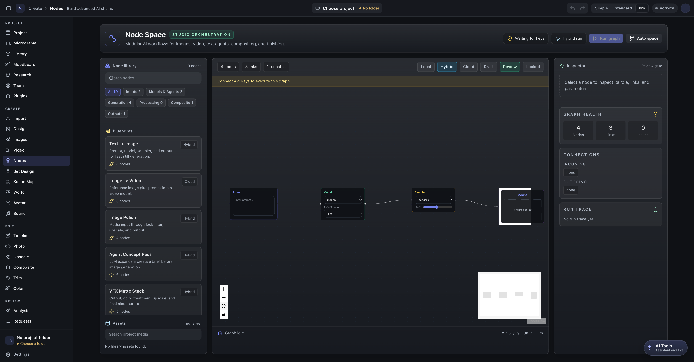
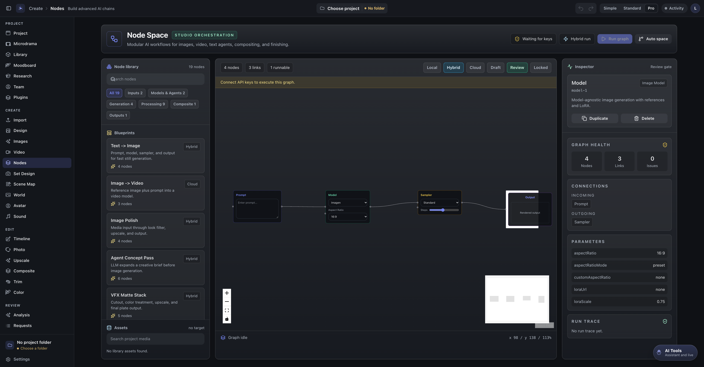

# Node Space: Text to Image

This guide walks through one real Node Space graph, node by node: **Text to
Image**, the four-node chain that turns a written prompt into a single still
image.

It is the graph Node Space opens with, so you can follow along before you
generate anything, and it is also the `Text -> Image` blueprint in the node
library if you want to insert a second copy of it.

Screenshots here are captured from the running app at the default state. They
are not mockups.

## What this workflow does

| | |
| --- | --- |
| Input | A text prompt you type into the Prompt node. |
| Output | One still image, added to the project's media and shown under **Latest outputs**. |
| Nodes | 4. |
| Backend | Hybrid (blueprint badge). |
| Nodes that call a provider | 1 — the Image Model node. |
| Cost to open and inspect | None. |
| Cost to run | One image generation on your own provider key. |

Use it for concept stills, poster ideas, shot frames, or anything where you want
one image from one sentence. It is the smallest complete graph in Node Space, so
it is also the clearest place to learn how nodes connect before moving on to the
image-to-video and compositing blueprints.

## Prerequisites

- **Node.js 20.19+ or 22.12+, npm 10+** if you are running from source
  (`package.json` `engines`). The desktop build needs neither.
- **The app running.** From source that is `npm install` then `npm run dev`
  (see [CONTRIBUTING](../CONTRIBUTING.md)).
- **A provider key, to run it.** The graph contains an Image Model node, so the
  app treats it as a graph that needs keys, and the Run button stays disabled
  until one is available. The default model is `Imagen`, which goes through the
  Gemini service, so the key this graph uses is a Gemini API key:
  `VITE_GEMINI_API_KEY` in `.env.local` when running from source, or your
  provider key stored in the app's own settings.

Opening the workspace, reading the graph, and editing the prompt all work with
no key at all. Only the generation step needs one. Nothing else in this guide
requires a second provider.

## The graph



*The workspace as it opens: the node library and blueprints on the left, the
graph in the middle, and the Inspector on the right.*

The four nodes, left to right, and the three connections between them:

```text
Prompt ──prompt──▶ Image Model ──model──▶ Sampler ──sampled──▶ Output
prompt-1           model-1                sampler-1            output-1
```

Each arrow is labelled with the port it leaves. The third one arrives on the
Output node's `image` port, so `sampled` and `image` are the two ends of that one
connection, not two different links.

Connection by connection, with the port names as the app labels them:

| # | From | Port | To | Port | Why it is needed |
| --- | --- | --- | --- | --- | --- |
| 1 | Prompt (`prompt-1`) | `prompt` | Image Model (`model-1`) | `prompt` | The model node has nothing to draw without text. It reads this instead of the box on the node itself. |
| 2 | Image Model (`model-1`) | `model` | Sampler (`sampler-1`) | `model` | The Sampler looks upstream for a model node to take its image from. Without this edge it reports `Sampler sampler-1 needs a model input.` |
| 3 | Sampler (`sampler-1`) | `sampled` | Output (`output-1`) | `image` | The Output node ends the chain. It is the node that makes the graph runnable, because it is a sink: nothing connects out of it. |

## Node by node

| Node on the canvas | What it is | Ports | What it does |
| --- | --- | --- | --- |
| **Prompt** | Text input | in `text`, out `prompt` | Holds the sentence you want an image of. |
| **Image Model** | Image generation | in `prompt`, in `image`, out `model` | Calls the provider with your prompt and returns one still image. |
| **Sampler** | Pass-through gate | in `model`, in `prompt`, out `sampled` | Carries the model's image to the Output node. |
| **Output** | Result sink | in `image` | Marks the end of the graph and collects the result. |

### Prompt

The node is headed **Prompt** and its text box reads *Enter prompt...*. Whatever
you type is the text the rest of the graph works from.

It has a `text` input as well as its `prompt` output, so a text node such as
**LLM Agent** can feed it. In this graph that input is unused.

If the box is empty when you run, the graph stops with `Prompt prompt-1 is
empty.`

### Image Model

The node is headed **Model** and appears in the node library as **Image Model**
under *Models & Agents*. It is the only node here that talks to a provider.



*Clicking the Model node fills the Inspector in. **Connections** shows **INCOMING**
Prompt and **OUTGOING** Sampler — the quickest way to confirm an edge landed on the
port you meant — and **Parameters** lists the keys the node is holding:
`aspectRatio`, `aspectRatioMode`, `customAspectRatio`, `loraUI`, `loraScale`. The
strip above the canvas reads `4 nodes`, `3 links`, `1 runnable`, and the chip says
**Waiting for keys** because this machine has no provider key configured.*

It needs:

- **A prompt.** From the Prompt node over the `prompt` port, or over the
  `image` port if you are doing reference-based generation instead.
- **A model selection.** The dropdown defaults to `Imagen`. The full list
  includes the Gemini, Flux, Seedream, Qwen, GPT Image, Runway and ControlNet
  families.
- **An aspect ratio.** Defaults to `16:9`, with `9:16`, `1:1`, `4:3`, `3:4`,
  `2:1`, `21:9`, `235:100` and `239:100` presets and a `Custom` option.

The *LoRA* fields appear only for models that support them (`Flux`,
`Flux 2 Klein`, `Flux 2 Turbo`, `Z-Image`, `Z-Turbo`). They are hidden for
Imagen, so do not go looking for them on the default model.

The `image` input is optional here — but four models require it
(`ControlNet`, `ControlNet Scribble`, `ControlNet Normal`, `Rodin 3D`), and they
refuse to run without an **Image In** node wired to it.

### Sampler

The node is headed **Sampler**. It reads the image from the model node upstream
of it and hands the same image on to the Output node through the `sampled` port.

It also accepts a `prompt` input, which is unused in this graph.

**In the current build the Sampler passes the image through unchanged.** Its
quality dropdown (`Standard`, `Cinematic`, `Fast`, `High Detail`) and its
`Steps` slider are drawn on the node, but the executor does not read either of
them: `case 'sampler'` in `src/workspaces/NodeWorkspace.tsx` resolves the
upstream image and returns it as-is. So changing those controls will not change
your output yet. The node still earns its place in the graph as the step the
Output node connects to, and it is where a real sampling pass would go.

### Output

The node is headed **Output**, and it is the end of the chain.

It is the only node the graph needs in order to run: the app looks for a sink
node — an Output, Video, Upscale, Filter, Composite, or similar node with
nothing connected out of it — and runs one pipeline per sink. That is why the
canvas toolbar reads `1 runnable` next to `4 nodes` and `3 links`.

Its preview box shows *Rendered output* until a run has produced something. For
this graph, the generated image appears under **Latest outputs** in the
Inspector and in the project's media rather than in the node's own preview box.

## Step by step

1. **Open Node Space.** In the sidebar, open the **Create** group and choose
   **Nodes**. The workspace header reads **Node Space**.
2. **Get the graph.** It is already there: Prompt, Model, Sampler and Output,
   wired as above. To rebuild it instead, open the **Text -> Image** card under
   **Blueprints** on the left — it inserts the same four nodes and three
   connections. To build it by hand, drag **Prompt**, **Image Model**,
   **Sampler** and **Output** from the node library onto the canvas and join the
   ports listed in the table above.
3. **Type a prompt.** Select the **Prompt** node and type into its text box, for
   example `A lighthouse keeper walking a cliff path at dawn, wide shot`.
4. **Configure the Image Model.** Select the **Model** node and choose a model
   (leave it on `Imagen` if you are using a Gemini key) and an aspect ratio.
5. **Check the graph is runnable.** The canvas toolbar should read `4 nodes`,
   `3 links`, `1 runnable`, and the chip next to **Run graph** should read
   **Ready**. With the Model node selected, the Inspector's **Graph health**
   panel reports `4 Nodes`, `3 Links`, `0 Issues`. If the chip reads **Needs
   review**, the amber strip under the toolbar lists what to fix; if it reads
   **Waiting for keys**, see Troubleshooting.
6. **Run it.** Press **Run graph**. It becomes **Running** while the pipeline
   executes.
7. **Watch the run.** The Inspector on the right fills in its **Run trace** as
   the pipeline is queued, running, and done. On success the status bar at the
   bottom of the canvas reports `Generated 1 asset.`
8. **Find the image.** It appears in the **Latest outputs** panel in the
   Inspector, and it is added to the project's media, so it is available to the
   other workspaces (Image Gen, Library, Export) from there.

## Troubleshooting

The app tells you what is wrong in two places: the chip next to **Run graph**,
and the amber strip under the toolbar, which lists up to three problems and
`+N more`.

| What you see | What it means | What to do |
| --- | --- | --- |
| Chip reads **Waiting for keys**, status `Connect your API keys to run pipelines.`, or the banner `Connect API keys to execute this graph.` | This graph has an Image Model node, so it needs a provider key. | Add a Gemini API key (or switch the model to one you have a key for) in the app's provider settings, then run again. Do not paste keys into an issue, a screenshot, or a shared project file. |
| `Prompt prompt-1 is empty.` | The Prompt node's text box is blank. | Type a prompt. The model node reads the upstream Prompt node, so the box on the Model node does not substitute for it. |
| `Add an Output, Video, or Upscale node to run.` | There is no sink node, so there is no pipeline to run. | Add an **Output** node and connect the Sampler's `sampled` port to its `image` port. |
| `Output output-1 needs a prompt node or an image input.` | The Output node has nothing feeding it. | Connect the Sampler's `sampled` port to the Output's `image` port. |
| `Output output-1 needs a model selection.` | No model is chosen on the model node. | Pick one in the **Model** dropdown. |
| `Output output-1 uses an unsupported model (X).` | That model is not one this graph can run as an image pipeline. | Choose a model from the dropdown rather than an edited value. |
| `Sampler sampler-1 needs a model input.` | The `model` edge from the Image Model node is missing. | Drag from the Model node's right-hand `model` port to the Sampler's `model` port. |
| `Sampler sampler-1 could not resolve image.` | The node upstream of the Sampler did not produce an image. | Check the model node ran, and that the Sampler is fed by the Model node and not by something else. |
| `Graph has a cycle. Remove circular connections.` | Connections loop back on themselves. | Remove the edge that points backwards. |
| Chip reads **Needs review** with no message you recognise | Validation found something the list did not fit in three lines. | Fix the listed errors; the strip shows the rest once those are cleared. |
| `No valid pipeline. Fix the validation errors and try again.` | Run was pressed while the graph was invalid. | Fix the listed errors first. |

Provider errors (a quota, an invalid key, a refused request) are reported by the
service that raised them in the **Run trace**, with the failing step marked
`error`. That message is the one to quote in a report; the key itself does not
appear in it.

## Limitations

- **This page documents the graph structure. It does not record a paid
  generation.** The screenshot is the real workspace at its default state. The
  run described in step 6 was not executed while writing this, because it needs
  your own provider key and spends your money. Everything above about what
  happens during a run comes from reading `src/workspaces/NodeWorkspace.tsx`,
  not from having watched a billable call.
- **The default model needs a key**, so the graph cannot be executed end to end
  without one. Opening, inspecting and editing it need nothing.
- **The Sampler is a pass-through in this build**, as described above. If it
  gains real sampling behaviour, the paragraph under *Sampler* and the note
  about its controls need updating with it.
- **The graph is saved with the project.** Node Space keeps its nodes and edges
  in the project's `nodeGraph`, so a graph is preserved by saving the project
  rather than by exporting a separate graph file. There is no standalone
  `.json` graph import/export to hand someone, so this guide shows the four
  nodes and three connections instead of shipping an example file.
- **Model names and provider support move.** The model list in the Image Model
  node tracks the adapters in `src/services`. If a model in your dropdown
  behaves differently from this page, the service module is the source of truth.

## Where the code lives

| Piece | File |
| --- | --- |
| The workspace, nodes, ports, validation and execution | `src/workspaces/NodeWorkspace.tsx` |
| The default graph that opens with the workspace | `initialNodes` / `initialEdges` in that file |
| The `Text -> Image` blueprint | `quickTemplateOptions` and `handleInsertQuickTemplate` in that file |
| Image model calls | `src/services/geminiService.ts`, `src/services/replicateService.ts`, `src/services/falAiService.ts` |
| Graph storage shape | `NodeGraphState` in `src/types.ts`, saved by `src/services/projectService.ts` |
